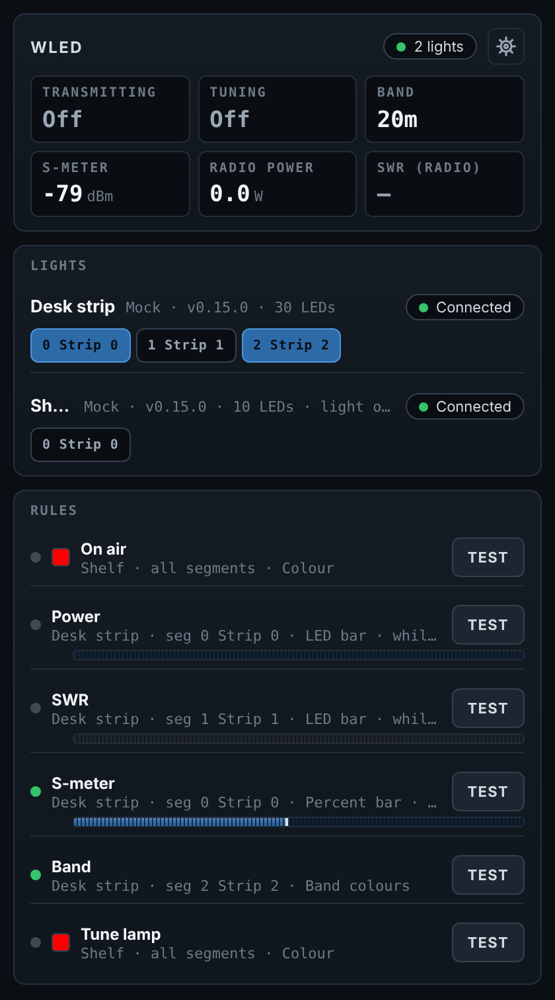
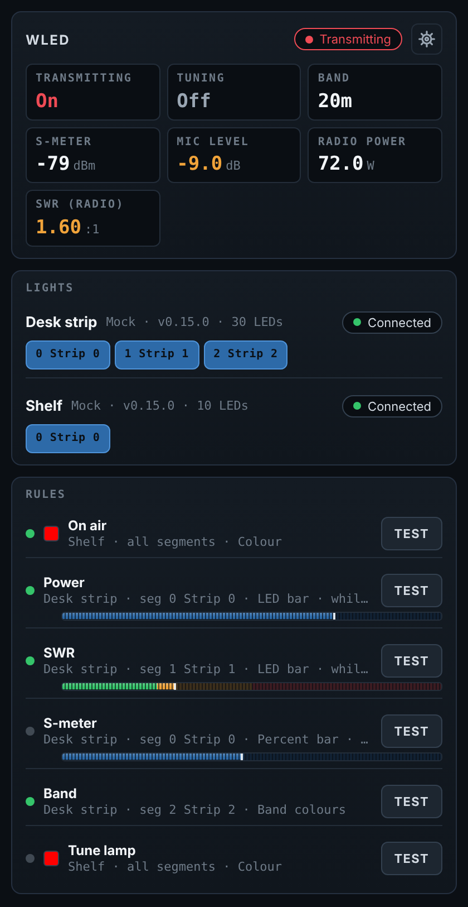
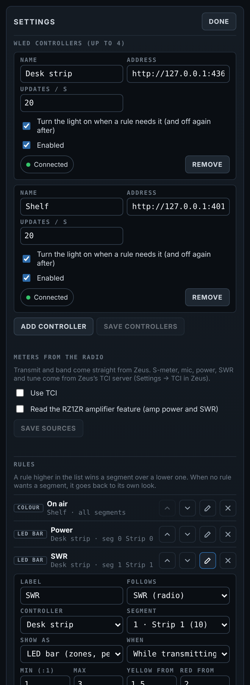
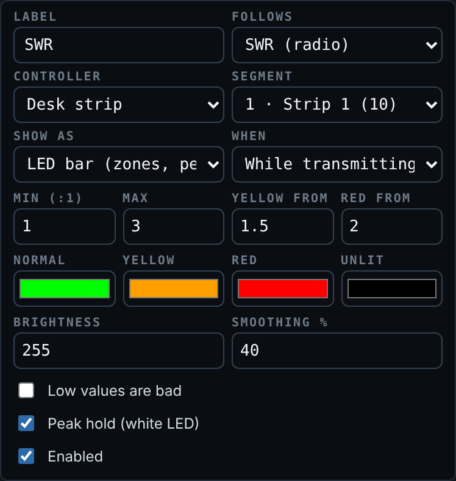

# WLED — Zeus community feature

Drive up to four WLED controllers from the radio: an on-air light, band colours, and bar meters for the
S-meter, power, SWR and mic level, segment by segment. The panel looks and behaves like the RZ1ZR LDMOS
amplifier and Home Assistant panels.

* **Rules** map one radio signal to one segment (or every segment) of one controller:

  | Follows | Shown as |
  | --- | --- |
  | Transmitting, Receiving, Tuning | a colour and any WLED effect (Solid, Blink, Breathe ...) with brightness, speed, intensity |
  | Band | a colour per band (160 m to 6 m, plus "other"), with any effect |
  | S-meter, Mic level, Radio power, SWR (radio), Amp power, SWR (amp) | a **Percent bar** (WLED's own Percent effect), an **LED bar** (LED by LED, green / yellow / red zones, white peak hold), or the **whole segment in the zone colour** |

* Meters can be limited to **while transmitting** or **while receiving** (S-meter defaults to receive, the rest to transmit),
  with your own scale, yellow and red thresholds (or "low is bad"), colours, brightness and smoothing.
* **Priority:** a rule higher in the list wins a segment over a lower one while both are active, so "On air" can
  sit on top of "Band colour" on the same strip.
* **Hands back what it borrowed:** when a rule takes a segment, that segment's own colours, effect, sliders and
  on/off are remembered and put back the moment no rule wants it, and when Zeus closes. A light that is switched
  off can be switched on while it is needed, and off again after (per controller).
* **Test** shows a rule on the lights for five seconds without keying the radio. Pressing a segment chip flashes
  that segment so you can find it.
* Different segments of one controller can do different jobs at the same time.

The feature only *reads* the radio. It never retunes, keys or changes anything in Zeus, and never sends anything
to the amplifier.

## Where the readings come from

| Signal | Source |
| --- | --- |
| Transmitting, band | Zeus itself (`ReadRadioState`): MOX and VFO frequency. If a Zeus build does not share radio state, transmit comes from TCI instead. |
| S-meter, mic level, radio power, SWR, tuning | Zeus's **TCI server** (on by default at `127.0.0.1:40001`): the `rx_sensors` / `tx_sensors` streams. Enable TCI in Zeus. The feature never sends a TCI command that changes the radio. |
| Amp power, amp SWR | The **RZ1ZR LDMOS Amplifier** feature's read-only `status` route on this Zeus. Zeus features cannot call each other directly, so this goes over HTTP. The address is found automatically: the WLED panel's own requests arrive on Zeus's API listener under its plugin prefix, so the amp's route is the same address with the other plugin id (open the WLED panel once after Zeus starts). An address can still be entered by hand. It is only polled while a rule uses it. |

## Setting up

1. In Zeus, add the **WLED** panel and press the gear.
2. Add your controllers (IP address or name, e.g. `192.168.1.50` or `wled-desk.local`) and **Save controllers**.
   Their segments, as set up in WLED, appear on the main panel.
3. Under **Meters from the radio**, check the TCI host and port, and tick the amplifier option if you have it.
4. **Add rule** for each mapping, then **Save rules**. Use **Test** to see each one.

Segments are defined in WLED itself (Config → LED Preferences, or the Segments panel). Give them names there and
the names show up here.

## How it talks to WLED

The JSON HTTP API: `GET /json/eff` once (effect names), `GET /json/si` every 2 s (segments and their looks), and
`POST /json/state` for changes. Only differences are sent, one request at a time per controller and at most
*Updates / s* (default 20) of them. If the radio changes faster than a controller can keep up, in-between frames are
dropped and the latest wins, so nothing queues up and the lights never lag behind.

* **Percent bar** sets the segment to the Percent effect and only moves its intensity, so each update is tiny.
* **LED bar** sends the colours as runs (`"i":[start,stop,"RRGGBB",...]`), which freezes the segment while it is
  drawn; touching any of the segment's own settings unfreezes it again.
* UDP realtime (DDP, E1.31) is not used: it takes over the whole controller, which would stop other segments doing
  their own thing.

## Build and test

    cd web && npm run build && cd ..
    dotnet build src/Zeus.Community.Wled/Zeus.Community.Wled.csproj -c Release
    dotnet run tests/Wled.Tests.cs          # 18 tests against mock WLED, TCI and amplifier
    cd src/Zeus.Community.Wled && pwsh ./build-package.ps1

### Try the panel without Zeus or lights

    cd web && npm run build && cp dist/wled.js ../tests/harness/ && cd ..
    # put React 18's UMD builds in tests/harness/vendor/ (react.production.min.js, react-dom.production.min.js)
    WLED_DEV_HOST=harness dotnet run tests/Wled.Tests.cs
    # open http://127.0.0.1:5199; /dev/tx?on=true, /dev/freq?hz=7074000, /dev/signal?id=smeter&value=-60 drive it

License: GPL-2.0-or-later.

## Screenshots

Rendered from the panel's real code and backend in the test harness with stand-in theme colours (Zeus supplies its own).

| Receiving | Transmitting | Settings | Rule editor |
| --- | --- | --- | --- |
|  |  |  |  |
